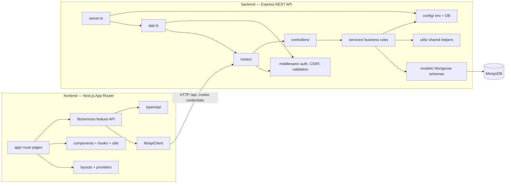
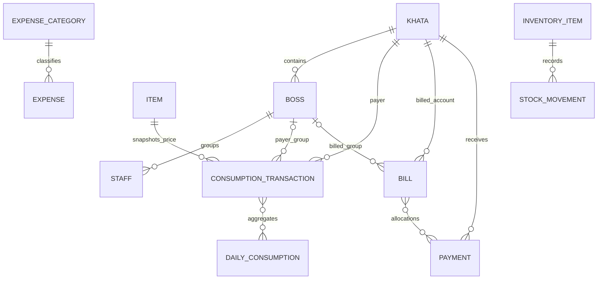

# Canteen Khata Codebase Graph

This is the code-navigation map for the current implementation. It combines a
high-level architecture graph with a generated, file-by-file local import
graph in [`codebase-graph.json`](./codebase-graph.json). The latter records
source file nodes and their relative import, re-export, dynamic-import, and
`require` edges (including source line numbers).

To rebuild the machine-readable graph after changing modules, run from the
repository root:

```powershell
node scripts/graphify.mjs
```

The generator uses the TypeScript compiler already installed with the backend.
It deliberately excludes dependencies, build output, coverage, and generated
declaration files. Package/external imports are not represented as local edges.

## Runtime and module layers



For exact file-to-file edges, use the JSON graph rather than expanding every
module in this overview diagram. A route handler typically applies Zod
validation and delegates to a controller; the controller calls a service,
which owns business logic and data access. `backend/app.ts` mounts middleware
and routes; `backend/server.ts` connects MongoDB and starts/shuts down HTTP.

## Feature and API navigation

| UI area / route | Frontend service | API route family | Backend flow |
|---|---|---|---|
| Login, setup | `authService` | `/auth` | auth routes → auth controller → auth service |
| Dashboard | `insightService` | `/dashboard` | dashboard routes → dashboard controller/service |
| Khatas | `khataService` | `/khatas` | khata routes → khata controller/service |
| Offices and bosses | `khataService` | `/offices`, `/bosses` | office/boss routes → boss controller → office service |
| Staff | `khataService` | `/staff` | staff routes → staff controller → office service |
| Items | `operationService` | `/items` | item routes → item controller/service |
| Khaja (consumption) | `operationService`, `khataService`, `insightService` | `/customers`, `/items`, `/consumption` | routes → customer/item/consumption controllers and services |
| Bills | `operationService`, `khataService` | `/bills` | bill routes → bill controller/service |
| Payments | `operationService`, `khataService` | `/payments` | payment routes → payment controller/service |
| Expenses | `expenseService` | `/expenses`, `/expense-categories` | routes → expense controller/service |
| Reports | `insightService` | `/reports` | report routes → report/dashboard/settings controllers → services |
| Audit log | `insightService` | `/audit-logs` | audit-log routes → settings controller → audit service |
| Settings | `insightService` | `/settings` | settings routes → settings controller/service |

Frontend pages call feature service modules. `frontend/lib/apiClient.ts` is the
shared HTTP boundary: it adds cookie credentials, serializes JSON/query
parameters, parses the API envelope, and raises `ApiError`. `base.ts` contains
shared response normalization (`paged`, `unwrap`). `operationService.ts`
groups item, consumption, bill, and payment API clients;
`insightService.ts` groups dashboard, customer search, reports, audit logs, and
settings clients.

## Core domain and data relationships



The consumer link on a consumption transaction is polymorphic
(`INDIVIDUAL`, `BOSS`, or `STAFF`), so it is intentionally not shown as a
single foreign-key edge in the ER diagram. `DailyConsumption` is a read model
derived from immutable transactions.

`Khata` is the payer/account root. An individual Khata bills directly; an
office Khata can contain several independent Boss billing groups, with Staff
as consumers under a boss. Financial events carry a `khataId` and optional
`bossId`; consumer identity is separate from who pays. `Item` price/cost and
consumer names are snapshotted onto consumption so history remains stable.

Important write/read paths:

1. **Consumption:** route → controller → `consumption.service` → append an
   immutable `ConsumptionTransaction` and update the `DailyConsumption`
   read-model in a Mongo transaction. A void creates a reversal rather than
   rewriting the original event.
2. **Billing:** `bill.service` uses daily aggregates and payer key
   `(khataId, bossId?)`, prior outstanding bills, and available payment credit;
   it writes the bill and audit record together.
3. **Payment:** `payment.service` allocates FIFO to open bills for the same
   payer key; any remainder becomes unallocated credit. Voids reverse
   allocations.
4. **Reporting:** dashboard/report services read consumption aggregates,
   bills, payments, expenses, and customer/office models. All monetary values
   are integer paisa; business dates use the Kathmandu date helpers.
5. **Audit:** mutations call `audit.service`; audit records preserve action,
   entity, actor, and before/after snapshots.

The detailed schema, billing/payment rules, edge cases, and security decisions
remain in [`PLAN.md`](./PLAN.md); model definitions under `backend/models/`
are authoritative for the deployed schema.

## Cross-cutting modules

- `backend/middleware/`: authentication, CSRF origin checks, request
  validation, rate limiting, and centralized errors.
- `backend/validators/`: Zod request schemas used by routes.
- `backend/utils/`: API errors/response envelopes, async handlers,
  pagination, paisa/date helpers, logging, and Mongo transaction support.
- `backend/models/index.ts`: registers and re-exports all Mongoose models.
- `backend/tests/`: Jest/Supertest API integration, health, and regression
  coverage using the test setup and in-memory MongoDB.
- `frontend/providers/`: auth and toast context; `frontend/proxy.ts` is a
  navigation guard for user experience, not the API authorization boundary.

## Current graph caveats

- This graph describes imports and documented runtime/data-flow relationships;
  it does not replace reading the specific implementation before changing
  behavior.
- `backend/src/services/period.service.ts` is outside the backend TypeScript
  build's configured `include`, is not imported by the active application,
  and refers to a missing `backend/src/utils/date` module. The active period
  helper is `backend/services/period.service.ts`; the unresolved legacy import
  remains visible in `codebase-graph.json` rather than being hidden.
- Update this graph when changing module ownership, route/service boundaries,
  or domain relationships, and rerun the generator to refresh the JSON edges.
